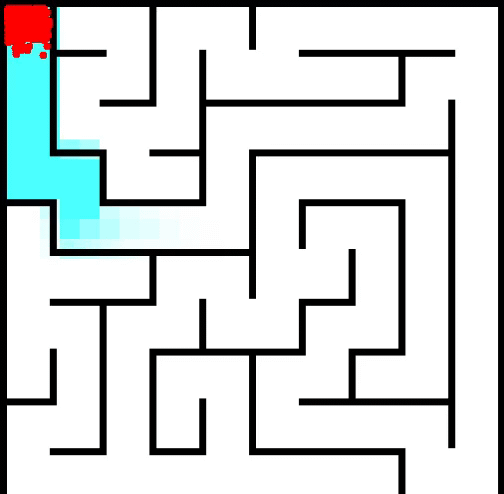

# Genetic-Algorithm
A simple genetic algorithm. A number of little dudes called "Brians" are tasked to navigate a maze, the algorithm selects for better Brians and strikes a good balance (or at least tries to) between exploration and reaching the opposite side of the maze. (The project name says "Sequential", but it is not, a different thread handles evolution.)

# Evolution Environment
The Program launches a simple java swing window that draws a maze with black walls, the Brians are dots that use their own Vector2 class to move. After time runs out, all Brians are evaluated based off their final position, where they land on a flood-fill matrix, how close they are to the bottom right, and heavily penalized for sitting in one spot, making extremely precise micro movements and of course, if they aren't close to the goal. Every generation after the first has their moves smoothed, and the genes carry over through tournament selection and splitting the paths 3 different parents take into equal segments that get fitted into each Brian.

